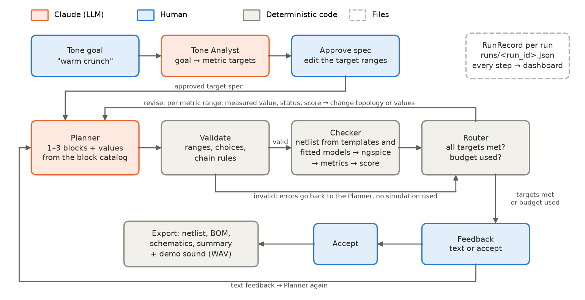

# Guitar Pedal Agent: multi-agent analog pedal design with SPICE feedback

AM/ME/CE 295 (Caltech, Fall 2026), solo project.

## What it is

You describe a guitar tone in words ("warm, mid-forward crunch"). A Claude **Tone Analyst** turns it into
measurable targets (gain at 1 kHz, THD, frequency-response peak, even/odd harmonic ratio, output level), which
you approve. A Claude **Planner** then designs a preamp/overdrive circuit as a chain of 1–3 blocks from a fixed
library, with knob and part values. Deterministic code validates the design, renders a SPICE netlist from trusted
templates, simulates it with **ngspice**, measures the metrics and feeds the numbers back. The Planner revises the
values *or the topology* (swap, add or remove blocks) until the targets are met or the 12-simulation budget is used.
You review the result, give feedback or accept it, and export the netlist, parts list, schematics and a demo sound.
LLM output is never executed; every netlist comes from a template filled with validated numbers.

**Research question.** Under equal simulation budgets, does an agent loop that can change topology (not only
component values) reach more specs than a fixed-topology parameter search and a single LLM?



*Figure: the design loop (LangGraph, `pedal_agent/graph.py`). Redraw with `python -m scripts.draw_architecture`.*

**Block library** (redrawn from General Guitar Gadgets (GGG) schematics; GGG PDFs are not redistributed):

| Block | Based on | Agent can change | Source |
|---|---|---|---|
| `od_ts808` | Tube Screamer TS-808 (GGG ITS8), soft clipping in the op-amp feedback | drive, tone, level, clipping diodes, C3, C4 | [GGG Tube Screamer](https://generalguitargadgets.com/effects-projects/distortion/tube-screamer/) |
| `dist_distplus` | MXR Distortion Plus (GGG DIST2), hard clipping to ground | gain, level, clipping diodes, C4, C7 | [GGG schematics](https://generalguitargadgets.com/how-to-build-it/technical-help/schematics/) |
| `fuzz_ff_si` | Fuzz Face, silicon (GGG), two direct-coupled NPN transistors | fuzz, volume, transistor model, R5, C1 | [GGG schematics](https://generalguitargadgets.com/how-to-build-it/technical-help/schematics/) |

Every chain is simulated between a guitar pickup model (6 kΩ, 2.5 H, 470 pF cable) and a 1 MΩ amp input.
Scope: preamp/overdrive signal path only (no power amp, speaker, physical build or listening tests).

## Setup (Windows)

Tested on Windows Server 2022 with Miniconda, Python 3.12.15 and ngspice 41 (conda-forge).

```powershell
conda create -n me295 -c conda-forge python=3.12 ngspice=41
conda activate me295
pip install -r requirements.txt          # versions pinned to the tested environment
pytest                                   # quick check, see Tests
```

ngspice comes from conda-forge into the environment (`Library\bin\ngspice_con.exe`, the console build that
`config.yaml` calls). On Linux/macOS set `ngspice.executable: "ngspice"` in `config.yaml`.

**If `conda` is not found** (common in the VS Code terminal, where conda is not on PATH), either:

- **Anaconda PowerShell Prompt:** open it from the Start menu, then
  `cd <repo>; conda activate me295` and run the commands below there; or
- **the scripts in this repo**, from any PowerShell in the repo folder:

  ```powershell
  . .\scripts\me295_env.ps1                # dot-source: puts the me295 env on PATH in this terminal
  powershell -ExecutionPolicy Bypass -File scripts\run_dashboard.ps1 -Fake    # start the dashboard
  ```

  They look for the environment in the usual Miniconda/Anaconda folders; otherwise pass
  `-EnvPath <folder with python.exe>` or set `ME295_ENV`.

## Claude access

- **Model:** pinned in `config.yaml` (`llm.model_id: claude-opus-5-5`, `llm.effort: medium`). The model ID is read
  only from there, never hardcoded. Temperature cannot be set, so reliability is measured with repeated runs.
- **Token route (used for all results).** The course Enterprise plan has no API keys; on the TA's recommendation
  the project uses a Claude Code OAuth token through the Claude Agent SDK (`llm.client: claude_agent_sdk`).
  Background and the approval record: [docs/agent_sdk_plan.md](docs/agent_sdk_plan.md).
  1. Install [Claude Code](https://claude.com/claude-code) and run `claude setup-token`.
  2. Create `.env` in the repo root with one line: `CLAUDE_CODE_OAUTH_TOKEN=<token>`.
     `.env` is gitignored: **never commit it**. The code never prints or stores the token.
  3. Optional check (one Planner call, uses plan usage): `python -m scripts.sdk_smoke`.
- **API key alternative:** `llm.client: anthropic_api` and `ANTHROPIC_API_KEY=...` in `.env`.
- **No Claude at all:** `--llm fake` (CLI) or `-Fake` / `PEDAL_DASHBOARD_LLM=fake` (dashboard) use `FakeLLM`, a
  scripted stand-in. Everything else (Validate, ngspice, metrics, export, audio) runs for real; the designs are
  not meaningful.

## Run it

Run everything from the repo root.

**Dashboard** (Streamlit, http://localhost:8501):

```powershell
streamlit run dashboard/app.py                               # real Claude (token in .env)
$env:PEDAL_DASHBOARD_LLM = "fake"; streamlit run dashboard/app.py   # no Claude use
```

Create a project (name, genre, description) → approve or edit the target ranges → the agent designs (the page
refreshes every 2 s) → read the signal chain, schematics, test results and design choices → send feedback or
**Accept** → **Export design**. One run is active at a time. `runs/example-jazz-christmas.json` is a read-only
illustrative example; benchmark runs (if present in `runs/bench/`) can be browsed too.

**Command line:**

```powershell
python -m pedal_agent run --goal "warm mid-forward overdrive" --llm fake         # no Claude
python -m pedal_agent run --goal "warm mid-forward overdrive"                    # asks to approve the spec
python -m pedal_agent run --goal "..." --auto-approve --no-feedback               # unattended, stays paused at the end
python -m pedal_agent run --goal "..." --mode baseline_fixed_topology             # Planner may only change values
```

Each run is written to `runs/<run_id>.json` after every step (paused runs resume from
`runs/checkpoints.sqlite`). At the end, type feedback, `accept`, or Enter to leave it paused.

**Export** (accepted runs only; never overwrites):

```powershell
python -m pedal_agent.export <run_id>     # → exports/<run_id>/
```

`netlist.cir` (the exact simulated netlist, SHA-256 checked against the Checker report), `bom.csv`,
`schematic_<n>_<block>.svg/.png` (connections checked against the netlist) and `summary.md`.

**Demo sound.** Put DI recordings in `audio/` as mono WAV, 44.1 or 48 kHz, about −6 dBFS peak, at least 8 s.
They appear in the dashboard's Demo sound selector; accepting a design renders every clip (measured 6.6–10.5 s per
8 s clip), and a **Render demo sound** button covers clips added later or runs accepted on the command line.
`audio/synthetic_plucks.wav` is generated on first use from fixed parameters (`python -m pedal_agent.audio
synth`; four plucked notes, then a strummed E major chord; gitignored). Assumptions: each clip is scaled to
0.3 V peak at the pickup (real hard picking reaches about 1 V); both players are normalized to −1 dBFS and the
real output level is shown; `config.yaml audio.oversample: 2` reduces aliasing on hard fuzz at about 1.5× the
render time.

**Single schematic:** `python -m pedal_agent.schematics od_ts808 drive=0.8 --out ts808.png`.

## Tests

```powershell
pytest              # quick suite: 254 tests, a few minutes; skips the slow ones
pytest --full       # adds full 12-simulation runs, the live dashboard flow and a real audio render (~3.5 min)
python -m tests.smoke_block      # DC/AC/THD smoke test of every block
```

- **No test uses Claude or the OAuth token.** `tests/test_real_run.py` (one full real run, roughly $1–2) runs
  only when `ANTHROPIC_API_KEY` is set and is skipped otherwise; `scripts/sdk_smoke.py` is the token check.
- The Checker is verified on known circuits before its results are used: RC low-pass −3 dB at 1/(2πRC)
  (`tests/test_rc_lowpass.py`), op-amp gain 1 + Rf/Rg and a pure sine's THD floor
  (`tests/test_checker_floor.py`), DC bias and distortion trends of each block (`tests/test_checker.py`).
- Safety: dangerous SPICE directives are rejected (`tests/test_rc_lowpass.py`, `tests/test_audio.py`).

## Reproduce the evaluation

The benchmark definition, labels and result summaries are committed; the raw run files (`runs/bench/`,
604 MB of JSON) are not. Steps 1–3 and 5 use no Claude; step 4 does. Times are from this machine (2 cores).

| Step | Command | Time | Claude |
|---|---|---|---|
| 1. Benchmark set v1 (seed 1116) | `python -m scripts.make_benchmarks --version v1 --seed 1116` | 13–17 min | no |
| 1b. Agent subset, analysis flag | `python -m scripts.make_subset --version v1 --seed 2611`; `python -m scripts.flag_defaults --version v1` | < 1 min | no |
| 2. Random baselines, full knob range [0, 1] | `python -m scripts.run_benchmark --set v1 --method <m> --seeds 20 --out runs/bench/v1_full_knobs/<m>` for `random_catalog`, `random_fixed_topology`, `random_fixed_topology_oracle` | about 2.5 h for the three | no |
| 2b. Random baselines, restricted range [0.05, 0.95] | the same on a commit before `34ce14e` (e.g. `git checkout 34ce14e~1`), `--out runs/bench/v1/<m>` | similar to step 2 | no |
| 3. Reachability check of the labels | `python -m scripts.reachability --version v1 --workers 2` | 29 min | no |
| 4a. Batch S: agent vs fixed topology (subset) | on frozen commit `b0044e1`: `python -m scripts.run_benchmark --set v1 --method <m> --targets subset --repeats A=3,B=5,C=5,D=2,hand=3 --llm real` for `agent`, `baseline_fixed_topology` | 63 + 60 min | yes |
| 4b. Targeted batch (G21, G22, G24, H5) | on commit `9d18848`: `python -m scripts.run_benchmark --set v1 --method agent --targets G21,G22,G24,H5 --seeds 5 --llm real --out runs/bench/v1_targeted/agent` | 27 min | yes |
| 5. Summaries | see below | < 1 min each | no |

Notes:
- **Step 1** rewrites the committed `benchmarks/v1*.yaml` and `v1_report.md`; `git diff` should then show only
  the generator commit, timestamp and run time. Checked on 2026-11-18 with the current code: targets, windows,
  categories and hidden solutions came out identical (`v1_solutions.yaml` byte-identical).
- **Step 3** also uses the single-block designs already simulated in `runs/bench/v1` as evidence, so run it after
  steps 2b and 4a (as originally done); its result is committed as `benchmarks/v1_labels_check.yaml`.
- **Step 4** uses Claude plan usage. Measured: batch S agent 2.32 M input / 0.27 M output tokens
  (API-equivalent $14.78, no per-token billing), `baseline_fixed_topology` 2.36 M / 0.26 M ($14.59);
  targeted batch 0.87 M / 0.12 M ($5.79).
  The runner prints an estimate and asks for a typed "yes", and refuses real-LLM batches when tracked files
  differ from the commit. LLM runs are not deterministic: expect similar rates, not identical runs.
- Every run is resumable: re-running the same command skips finished runs.
- A quick difficulty check without the graph: `python -m scripts.baseline_success --version v1 --seeds 20`.

Summaries (written to [docs/results/](docs/results/)):

```powershell
python -m scripts.summarize_benchmark runs/bench/v1 --out docs/results/batch_s_original_labels
python -m scripts.summarize_benchmark runs/bench/v1 --labels checked --out docs/results/batch_s_checked_labels
python -m scripts.summarize_benchmark runs/bench/v1_full_knobs --out docs/results/random_full_knobs_original_labels
python -m scripts.summarize_benchmark runs/bench/v1_full_knobs --labels checked --out docs/results/random_full_knobs_checked_labels
python -m scripts.summarize_benchmark runs/bench/v1_targeted runs/bench/v1_full_knobs --labels checked --out docs/results/targeted_checked_labels
```

## Component models

All results use the real model set (`config.yaml models.set: real`), fitted by this project to manufacturer
datasheets because no manufacturer model could be redistributed. Details, datasheet links with SHA-256 of the
downloaded PDFs, fit errors and sensitivity ranges: [models/README.md](models/README.md).

- **Op-amps** (`models/opamps.lib`): our behavioural macromodel with JRC4558 and LM741 datasheet values.
- **Diodes** (`models/diodes_fitted.lib`): 1N914 and a red LED fitted to datasheet I–V curves
  (`python -m scripts.fit_diodes`, points in `models/diode_points.yaml`).
- **Transistors** (`models/bjts_fitted.lib`): Gummel–Poon fits of 2N4401, 2N3904 and BC549C
  (`python -m scripts.fit_bjts`, points in `models/bjt_points.yaml`).
- The germanium diode (`DGE`) has no datasheet data: it is flagged unvalidated and rejected by Validate, so no
  reported result uses it. `fuzz_ff_si` is the least data-supported block.
- Datasheet PDFs (and GGG schematics) are **not redistributed**: links only.

## Results

Full analysis: [docs/phase3_plan.md](docs/phase3_plan.md) (sections 1c–1e); tables: [docs/results/](docs/results/).
Success = every metric in its window within 12 simulations; 95 % Wilson intervals.

- **Batch S** (12-target subset, 51 runs per LLM method): agent 34/51 = 67 % [53–78],
  fixed-topology agent 31/51 = 61 % [47–73], random catalog 19 %, random fixed topology 19 %, oracle 72 %.
  A stronger reachability check then showed that nearly all of these targets are reachable with the start
  block (`od_ts808`) at knob end stops, so batch S compares the methods on targets that do **not** need a
  topology change.
- **Targeted batch** on the 4 targets that do need another topology (G21, G22, G24, H5): agent 18/20 = 90 %
  [70–97] vs random catalog 25/80 = 31 % [22–42], random fixed topology 0/80 and the oracle (random values on the
  hidden solution's chain) 26/60 = 43 % [32–56] on the three generated targets. Every agent run changed topology.
- **Answer so far:** an indication that the topology-changing agent finds topology changes when they are needed,
  not an established result (4 targets × 5 runs).

**Limitations** (full list in [docs/phase3_plan.md](docs/phase3_plan.md), section 4b):
- After relabelling only 4 of 36 benchmark targets need another topology; a v2 benchmark with many such targets
  is future work.
- The single-LLM baselines from the project plan (one candidate; same tools without the role split) were not run.
- Targets are wide metric windows at one input level (300 mV); touch sensitivity and dynamics are not measured.
- The agent may use 3-block chains, the random baselines draw 1–2 (one of the 18 targeted successes used 3).
- Simulation only, with fitted models: no physical build or listening test; the demo sound can alias on hard fuzz.

## Repository layout

```
pedal_agent/          agent package: graph (LangGraph loop), llm, prompts, validate, checker, router, cli,
                      build (templates), harness (pickup + load), actions (dashboard backend), export,
                      audio (demo sound), schematics/, baselines/, tools/simulate.py (the only way to run ngspice)
blocks/<id>/          block.yaml (parameters, ranges, catalog text) + template.cir.j2 (netlist template)
models/               fitted part models and their README
dashboard/            Streamlit app (app.py, charts.py, data.py)
benchmarks/           benchmark v1: targets, hidden solutions, report, subset, label check
scripts/              benchmark generation, runner, summaries, reachability, model fits, figures, launchers
tests/                pytest suite
docs/                 plans (DASHBOARD_SPEC, phase2_design, phase3_plan, agent_sdk_plan, models_plan),
                      architecture figure, results/
audio/                DI clips for the demo sound
config.yaml           pinned model ID, budgets, ngspice, audio settings
runs/, exports/, results/, logs/   local outputs (gitignored, except runs/example-jazz-christmas.json)
```

## AI use

Claude on claude.ai was used for design discussions and reviews; Claude Code (in VS Code) wrote most of the
implementation, tests and documentation under my direction and review, with my approval before every commit.
[LOG.md](LOG.md) records every Claude Code contribution (date, what, files) for the AI use declaration.
Inside the system, Claude (pinned model above) is the Tone Analyst and Planner; all checking, simulation and
scoring is deterministic code.
